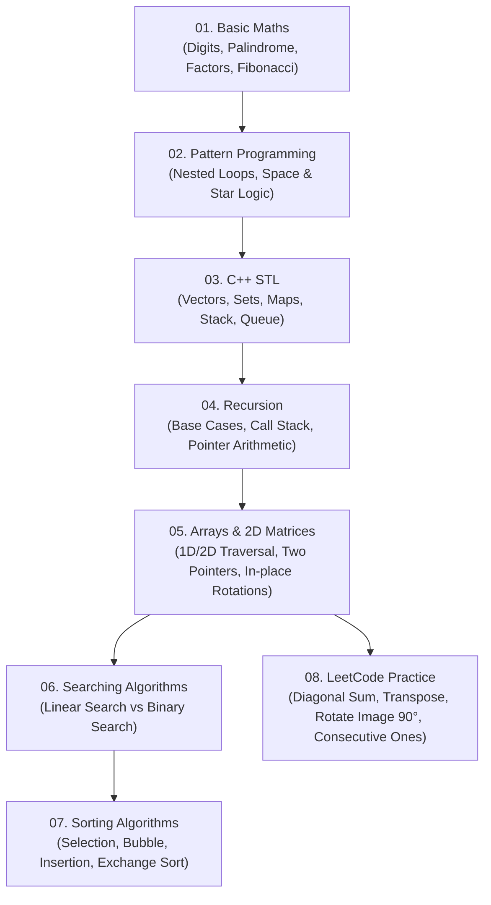

# Data Structures & Algorithms in C++ (DSA Roadmap)

Welcome to your structured DSA repository! This repository organizes your personal journey through fundamental Data Structures and Algorithms in C++, starting from the absolute basics (Math and Patterns) up through Standard Template Library (STL), Recursion, Arrays, 2D Matrices, Searching, Sorting, and LeetCode problem solutions.

---

## 🗺️ Recommended Learning Roadmap

Study and revise the topics in this sequential order:



---

## 📂 Repository File Structure

```text
dsa_cpp/
├── 01_maths/
│   ├── basic_maths_part1.cpp          # Digit extraction, count, reverse, palindrome, min/max digit
│   └── basic_maths_part2.cpp          # Loops 1-to-N, tables, factorial, Fibonacci, divisors/factors
│
├── 02_patterns/
│   ├── 01_basic_patterns.cpp          # Squares, right triangles, inverted triangles, Floyd's, 0-1
│   ├── 02_medium_patterns.cpp         # Half pyramids, number and character pyramids
│   ├── 03_advance_patterns.cpp        # Full pyramids, inverted pyramids, diamond patterns
│   └── 04_hard_patterns.cpp           # Mirrored pyramids, hollow diamonds, concentric number spiral
│
├── 03_stl/
│   ├── stl_containers_overview.cpp    # Vector, Deque, List, Set, Map, Stack, Queue, Priority Queue
│   └── vector_operations.cpp          # Vector iterations, push_back, pop_back demos
│
├── 04_recursion/
│   ├── 01_recursion_basics.cpp        # Factorial, 1-to-N, N-to-1, recursive vector printing
│   ├── 02_recrussion.cpp              # Forward/rev counting, recursive sum, average, factorial
│   ├── 03_recrussion.cpp              # Pointer-based array recursion: check sorted, sum, print
│   ├── diagrams/
│   │   ├── recursion_call_stack.png       # Call stack memory diagram
│   │   ├── reverse_array_extra_vector.png # Auxiliary array recursion trace
│   │   └── reverse_array_two_pointer.png  # Two-pointer swap recursion trace
│   └── practice/
│       ├── recursive_linear_search.cpp    # Linear search implemented via recursion
│       ├── reverse_array_extra_vector.cpp # Array reversal with extra vector (O(N) space)
│       └── reverse_array_two_pointer.cpp  # Array reversal in-place with two pointers (O(1) aux space)
│
├── 05_arrays/
│   ├── 01_array_basics.cpp            # Static array declarations, garbage values, char arrays
│   ├── 02_array_operations.cpp        # Array traversal, doubling, even/odd, count 0/1, min/max
│   ├── 03_array_problems.cpp          # Check sorted, Two Sum, Max Consecutive Ones, Left/Right Rotate
│   ├── array2d.cpp                    # 2D arrays & vectors, row/col-wise traversal, row/col sum, matrix search
│   └── ArrayAll.cpp                   # Comprehensive 1D operations: sum, avg, 2nd min/max, shuffle, palindrome
│
├── 06_searching/
│   ├── linear_search.cpp              # Linear search algorithm (O(N))
│   └── binary_search.cpp              # Binary search on sorted array (O(log N))
│
├── 07_sorting/
│   └── sorting.cpp                    # Selection Sort, Bubble Sort, Insertion Sort, Exchange Sort
│
├── leetcode/
│   └── arrays/
│       ├── lc_0033_search_in_rotated_sorted_array.cpp
│       ├── lc_0034_find_first_and_last_position_of_element_in_sorted_array.cpp
│       ├── lc_0048_rotate_image.cpp
│       ├── lc_0069_sqrtx.cpp
│       ├── lc_0074_search_a_2d_matrix.cpp
│       ├── lc_0088_merge_sorted_array.cpp
│       ├── lc_0485_max_consecutive_ones.cpp
│       ├── lc_0724_find_pivot_index.cpp
│       ├── lc_0867_transpose_matrix.cpp
│       ├── lc_1470_shuffle_the_array.cpp
│       ├── lc_1572_matrix_diagonal_sum.cpp
│       └── lc_1991_find_the_middle_index_in_array.cpp
│
├── .gitignore                         # Ignores executables (*.exe, *.out, build/)
└── README.md                          # Repository documentation & guide
```

---

## 🔄 File Contents & Quick Reference

Use this lookup table to quickly locate any file and understand what it covers:

| Category | File Path | What it Covers |
| :--- | :--- | :--- |
| **01 Maths** | `01_maths/basic_maths_part1.cpp` | Digit extraction, palindrome, min/max digits, sum of digits |
| **01 Maths** | `01_maths/basic_maths_part2.cpp` | Loops 1-to-N, Fibonacci, Factorial, proper factors |
| **02 Patterns** | `02_patterns/01_basic_patterns.cpp` | 12 starter pattern problems (squares, triangles, Floyd's, 0-1) |
| **02 Patterns** | `02_patterns/02_medium_patterns.cpp` | Intermediate pyramid & triangle patterns |
| **02 Patterns** | `02_patterns/03_advance_patterns.cpp` | Full pyramids & diamond patterns |
| **02 Patterns** | `02_patterns/04_hard_patterns.cpp` | Hollow diamonds & concentric number spiral |
| **03 STL** | `03_stl/stl_containers_overview.cpp` | Complete STL container guide with generic print templates |
| **03 STL** | `03_stl/vector_operations.cpp` | Vector traversal methods and `.pop_back()` behavior |
| **04 Recursion** | `04_recursion/01_recursion_basics.cpp` | Core recursion (factorial, 1-to-N, vector traversal) |
| **04 Recursion** | `04_recursion/02_recrussion.cpp` | Forward/reverse counting, recursive vector sum & average, factorial |
| **04 Recursion** | `04_recursion/03_recrussion.cpp` | Pointer arithmetic recursion (`arr + 1`, `size - 1`), check if array is sorted, array sum |
| **04 Recursion** | `04_recursion/diagrams/` | Call stack memory & two-pointer swap hand traces |
| **04 Recursion** | `04_recursion/practice/recursive_linear_search.cpp` | Linear search using recursion |
| **04 Recursion** | `04_recursion/practice/reverse_array_extra_vector.cpp` | Reverse array via recursion with new vector |
| **04 Recursion** | `04_recursion/practice/reverse_array_two_pointer.cpp` | Reverse array via recursion using two pointers |
| **05 Arrays** | `05_arrays/01_array_basics.cpp` | Static arrays, memory garbage values, char arrays |
| **05 Arrays** | `05_arrays/02_array_operations.cpp` | Min/max, counting 0s/1s, even/odd, basic search |
| **05 Arrays** | `05_arrays/03_array_problems.cpp` | Check sorted, Two Sum, Consecutive Ones, Rotate by 1, Vector Reverse |
| **05 Arrays** | `05_arrays/array2d.cpp` | 2D array row/col traversal, row/col sum vectors, matrix search & min/max |
| **05 Arrays** | `05_arrays/ArrayAll.cpp` | 14+ utility operations (sum, avg, 2nd min/max, Fisher-Yates shuffle, palindrome, sorting) |
| **06 Searching** | `06_searching/linear_search.cpp` | Iterative linear search with detailed notes |
| **06 Searching** | `06_searching/binary_search.cpp` | Binary search with overflow-safe mid calculation |
| **07 Sorting** | `07_sorting/sorting.cpp` | Selection Sort, Bubble Sort, Insertion Sort, and Exchange Sort |
| **LeetCode** | `leetcode/arrays/lc_0033_search_in_rotated_sorted_array.cpp` | LC 33: Search in Rotated Sorted Array ($O(\log N)$) |
| **LeetCode** | `leetcode/arrays/lc_0034_find_first_and_last_position_of_element_in_sorted_array.cpp` | LC 34: Find First and Last Position in Sorted Array ($O(\log N)$) |
| **LeetCode** | `leetcode/arrays/lc_0048_rotate_image.cpp` | LC 48: Rotate Image 90° clockwise in-place ($O(N^2)$) |
| **LeetCode** | `leetcode/arrays/lc_0069_sqrtx.cpp` | LC 69: Sqrt(x) using Binary Search ($O(\log x)$) |
| **LeetCode** | `leetcode/arrays/lc_0074_search_a_2d_matrix.cpp` | LC 74: Search a 2D Matrix ($O(\log(m \cdot n))$) |
| **LeetCode** | `leetcode/arrays/lc_0088_merge_sorted_array.cpp` | LC 88: Merge Sorted Array ($O(m + n)$ optimal backwards) |
| **LeetCode** | `leetcode/arrays/lc_0485_max_consecutive_ones.cpp` | LC 485: Max Consecutive Ones ($O(N)$) |
| **LeetCode** | `leetcode/arrays/lc_0724_find_pivot_index.cpp` | LC 724: Find Pivot Index ($O(N)$ prefix/total sum) |
| **LeetCode** | `leetcode/arrays/lc_0867_transpose_matrix.cpp` | LC 867: Transpose Matrix ($O(R \cdot C)$) |
| **LeetCode** | `leetcode/arrays/lc_1470_shuffle_the_array.cpp` | LC 1470: Shuffle the Array ($O(N)$) |
| **LeetCode** | `leetcode/arrays/lc_1572_matrix_diagonal_sum.cpp` | LC 1572: Matrix Diagonal Sum ($O(N)$) |
| **LeetCode** | `leetcode/arrays/lc_1991_find_the_middle_index_in_array.cpp` | LC 1991: Find the Middle Index in Array ($O(N)$) |

---

## 📚 Module-by-Module Guide & Key Concepts

### 1. Basic Maths (`01_maths/`)
Fundamental mathematical techniques required for DSA problem solving.
- **Digit Extraction**: Extract digits right-to-left using `n % 10`, remove the last digit using `n / 10`.
  - Time Complexity: \(O(\log_{10} N)\) because dividing by 10 reduces the number of digits by 1 in each step.
- **Palindrome Check**: Rebuild the reversed number (`rev = rev * 10 + digit`) and compare with the original value.
- **Fibonacci Sequence**: Iterative calculation using two rolling variables `t1` and `t2` (\(O(N)\) time, \(O(1)\) space).
- **Factors / Divisors**: Scanning divisors up to `N` (optimization tip: check up to \(\sqrt{N}\) for \(O(\sqrt{N})\) complexity).

### 2. Pattern Programming (`02_patterns/`)
Building nested loop intuition and mental models for matrix coordinates `(i, j)`.
- **The 3 Golden Rules of Pattern Printing**:
  1. **Outer loop (`i`)**: Controls rows (`0` to `n - 1` or `1` to `n`).
  2. **Inner loop 1**: Prints leading spaces if the pattern is right-aligned or centered.
  3. **Inner loop 2**: Prints stars, numbers, or characters based on a formula relating to row `i`.
- **Patterns covered**:
  - Right-angled triangles, inverted triangles, symmetric pyramids.
  - Number pyramids, alternating binary triangles (`0-1` pattern).
  - Floyd's triangle (continuous sequence of incrementing integers).
  - Number Crown (symmetric numbers with decreasing spaces in the middle).
  - Concentric square numbers (boundary-based minimum distance formula `min(min(i, j), min(2*n-2-i, 2*n-2-j))`).

### 3. C++ Standard Template Library (`03_stl/`)
Mastery over C++ STL containers and algorithms:
- **Sequence Containers**:
  - `std::vector`: Dynamic continuous array, \(O(1)\) amortized push_back, random access \(O(1)\).
  - `std::deque`: Double-ended queue, \(O(1)\) push/pop at both front and back.
  - `std::list`: Doubly-linked list, \(O(1)\) insertions/deletions anywhere given an iterator.
  - `std::array`: Fixed-size wrapper over C-style array with STL interface.
- **Associative Containers**:
  - `std::set` / `std::map`: Self-balancing Red-Black trees, elements sorted, \(O(\log N)\) insert/find/erase.
- **Unordered Associative Containers**:
  - `std::unordered_set` / `std::unordered_map`: Hash tables, \(O(1)\) average insert/find/erase, \(O(N)\) worst case on hash collisions.
- **Container Adaptors**:
  - `std::stack`: LIFO (Last-In-First-Out) adaptor (`push`, `pop`, `top`).
  - `std::queue`: FIFO (First-In-First-Out) adaptor (`push`, `pop`, `front`).
  - `std::priority_queue`: Heap-based (Max-Heap by default), \(O(\log N)\) push/pop, \(O(1)\) top.

### 4. Recursion (`04_recursion/`)
Thinking recursively: breaking large problems into smaller identical sub-problems.
- **Anatomy of Recursion**:
  1. **Base Case**: The stopping condition that prevents infinite calls and stack overflow.
  2. **Self Work / Small Computation**: What this specific frame computes.
  3. **Recursive Call**: Calling the function with modified arguments moving towards the base case.

- **Files in this Module**:
  - **`01_recursion_basics.cpp`**: Core concepts — Factorial calculation (\(O(N)\)), printing 1 to 5, printing 5 to 10, and printing elements of a vector recursively.
  - **`02_recrussion.cpp`**:
    - Counting reverse (`printcountingREV`): prints $N$ down to 1.
    - Counting forward (`printcountingFwd`): prints 1 up to $N$ using an index default parameter.
    - Recursive vector summation (`calculateSUM`): `nums[size-1] + calculateSUM(nums, size-1)`.
    - Recursive average calculation (`calculateAvg`): divides recursive sum by size.
    - Factorial with clean $N = 0$ base case.
  - **`03_recrussion.cpp`**:
    - **Pointer Arithmetic Recursion Pattern**: Demonstrates passing `arr + 1` and decrementing `size - 1` without maintaining separate index variables.
    - **Check if Array is Sorted (`isVectorSorted`)**:
      - Base case: `size <= 1` $\to$ `true`.
      - Check: if `arr[0] > arr[1]` $\to$ `false`.
      - Recurse: `isVectorSorted(arr + 1, size - 1)`.
    - Recursive array traversal and summation using raw pointers.
  - **`practice/recursive_linear_search.cpp`**: Finding target recursively with safe boundary checks.
  - **`practice/reverse_array_extra_vector.cpp`**: Reverse array recursively by pushing into a new vector (\(O(N)\) space).
  - **`practice/reverse_array_two_pointer.cpp`**: In-place two-pointer recursive swap (\(O(1)\) auxiliary memory).
  - **`diagrams/`**: Hand-drawn traces of call stacks and two-pointer swap mechanisms.

### 5. Arrays & 2D Matrices (`05_arrays/`)
Contiguous memory data structures, matrix operations, and fundamental algorithmic patterns.
- **`01_array_basics.cpp`**:
  - Static vs dynamic arrays.
  - Understanding uninitialized stack memory (garbage values).
  - Character arrays and null termination.
- **`02_array_operations.cpp`**:
  - Linear scan for finding minimum and maximum elements in \(O(N)\).
  - Counting occurrences of specific values (e.g. 0s and 1s).
  - Filtering even and odd numbers.
- **`03_array_problems.cpp`**:
  - **Check if Array is Sorted**: Single-pass adjacent comparison \(O(N)\).
  - **Two Sum (Brute Force)**: Nested loops checking all pairs \((i, j)\) summing to target (\(O(N^2)\) time, \(O(1)\) space).
  - **Max Consecutive Ones**: Tracking current streak `cs` and best streak `ans` (\(O(N)\) time).
  - **Left Rotate by 1**: Storing `arr[0]`, shifting all elements left, placing `arr[0]` at the end.
  - **Right Rotate by 1**: Storing `arr[n-1]`, shifting elements right, placing `arr[n-1]` at index 0.
  - **Two-Pointer Vector Reverse**: Swapping `arr[left]` and `arr[right]` while `left < right` in \(O(N)\) time and \(O(1)\) space.
- **`array2d.cpp` (2D Arrays & 2D Vectors)**:
  - **Row-major Traversal**: Iterating row by row (`arr[i][j]`).
  - **Column-major Traversal**: Iterating column by column (`arr[j][i]`).
  - **Row-wise Sum Vector**: Accumulating sums of each row into a 1D vector.
  - **Column-wise Sum Vector**: Accumulating sums of each column into a 1D vector.
  - **Matrix Linear Search**: Finding `(row, col)` coordinate of a target in a 2D matrix in \(O(R \times C)\).
  - **Matrix Min/Max**: Finding extreme values across dynamic 2D vectors.
- **`ArrayAll.cpp` (Comprehensive Utility Suite)**:
  - Average, sum, max, and min calculations.
  - **Second Maximum & Second Minimum**: Single-pass boundary updates without full sorting.
  - **Randomization (Fisher-Yates Shuffle)**: Randomly shuffling array elements in \(O(N)\) time using `rand() % (i + 1)` and `swap()`.
  - **Palindrome Verification**: Two-pointer outer-to-inner symmetric equality checks.
  - In-place reversing, deep copying, and sort verification.

### 6. Searching Algorithms (`06_searching/`)
Comparing sequential search with logarithmic divide-and-conquer search.

| Algorithm | Precondition | Best Time | Worst Time | Space | Notes |
| :--- | :--- | :--- | :--- | :--- | :--- |
| **Linear Search** | None (works on unsorted arrays) | \(O(1)\) | \(O(N)\) | \(O(1)\) | Simple, best for small or unsorted datasets |
| **Binary Search** | **Array must be sorted** | \(O(1)\) | \(O(\log N)\) | \(O(1)\) | Halves search space each step |

> [!TIP]
> **Preventing Integer Overflow in Binary Search**:
> Instead of calculating `mid = (left + right) / 2` (which can overflow `int` if `left + right > INT_MAX`), always use:
> ```cpp
> int mid = left + (right - left) / 2;
> ```

### 7. Sorting Algorithms (`07_sorting/`)
Comparison-based sorting algorithms implemented in `07_sorting/sorting.cpp`:

- **Selection Sort**:
  - **Concept**: Divides the array into sorted and unsorted regions. In each pass, finds the minimum element in the unsorted portion and swaps it with the first unsorted element.
  - **Time Complexity**: \(O(N^2)\) in all cases (best, average, worst).
  - **Space Complexity**: \(O(1)\) in-place.
- **Bubble Sort**:
  - **Concept**: Repeatedly steps through the array, compares adjacent elements, and swaps them if they are in the wrong order. Larger elements "bubble up" to the end with each pass.
  - **Optimization**: Uses a `blockswap` flag. If no swaps occur in a full pass, the array is already sorted, terminating early in \(O(N)\).
  - **Time Complexity**: \(O(N^2)\) worst/average, \(O(N)\) best case.
  - **Space Complexity**: \(O(1)\) in-place.
- **Insertion Sort**:
  - **Concept**: Builds the sorted array one element at a time. Takes the element at `i` and repeatedly swaps it backwards while it is smaller than its preceding neighbor.
  - **Analogy**: Similar to sorting playing cards in your hand.
  - **Time Complexity**: \(O(N)\) best case (when already sorted), \(O(N^2)\) worst case.
  - **Space Complexity**: \(O(1)\) in-place.
- **Exchange Sort**:
  - **Concept**: Compares the current element `vec[i]` against all subsequent elements `vec[j]` ($j > i$) and swaps immediately whenever an out-of-order pair is found.
  - **Time Complexity**: \(O(N^2)\) in all cases.
  - **Space Complexity**: \(O(1)\) in-place.

#### Sorting Comparison Matrix

| Algorithm | Best Time | Average Time | Worst Time | Space | Stable? | In-Place? | Key Mechanism |
| :--- | :---: | :---: | :---: | :---: | :---: | :---: | :--- |
| **Selection Sort** | \(O(N^2)\) | \(O(N^2)\) | \(O(N^2)\) | \(O(1)\) | No | Yes | Find minimum element, swap to current index |
| **Bubble Sort** | \(O(N)\)* | \(O(N^2)\) | \(O(N^2)\) | \(O(1)\) | Yes | Yes | Swap adjacent out-of-order elements (*with swap flag) |
| **Insertion Sort** | \(O(N)\) | \(O(N^2)\) | \(O(N^2)\) | \(O(1)\) | Yes | Yes | Repeatedly swap backwards into sorted partition |
| **Exchange Sort** | \(O(N^2)\) | \(O(N^2)\) | \(O(N^2)\) | \(O(1)\) | No | Yes | Swap whenever `vec[i] > vec[j]` across nested loops |

### 8. LeetCode Practice (`leetcode/arrays/`)
Dedicated competitive programming problem solutions, organized cleanly and numbered by question:

1. **LeetCode 33: Search in Rotated Sorted Array (`lc_0033_search_in_rotated_sorted_array.cpp`)**:
   - Modified Binary Search determining which half is continuously sorted, then checking if the target falls within that sorted segment.
   - **Complexity**: \(O(\log N)\) time, \(O(1)\) space.

2. **LeetCode 34: Find First and Last Position of Element in Sorted Array (`lc_0034_find_first_and_last_position_of_element_in_sorted_array.cpp`)**:
   - Two Binary Searches (`startSearch` and `endSearch`) isolating the first and last target occurrences.
   - **Complexity**: \(O(\log N)\) time, \(O(1)\) auxiliary space.

3. **LeetCode 48: Rotate Image (`lc_0048_rotate_image.cpp`)**:
   - Rotates an \(N \times N\) matrix 90° clockwise in-place:
     1. Transpose the square matrix in-place (`swap(matrix[i][j], matrix[j][i])`).
     2. Reverse each row using `std::reverse`.
   - **Complexity**: \(O(N^2)\) time, \(O(1)\) auxiliary space.

4. **LeetCode 69: Sqrt(x) (`lc_0069_sqrtx.cpp`)**:
   - Binary Search over range $[1, x/2]$ to find $\lfloor \sqrt{x} \rfloor$ with `long long` overflow prevention.
   - **Complexity**: \(O(\log x)\) time, \(O(1)\) space.

5. **LeetCode 74: Search a 2D Matrix (`lc_0074_search_a_2d_matrix.cpp`)**:
   - 2-stage Binary Search: row binary search in \(O(\log m)\) followed by column binary search in \(O(\log n)\).
   - **Complexity**: \(O(\log(m \cdot n))\) time, \(O(1)\) space.

6. **LeetCode 88: Merge Sorted Array (`lc_0088_merge_sorted_array.cpp`)**:
   - Approach 1: Append `nums2` and `std::sort()` in \(O((m + n)\log(m + n))\).
   - Approach 2 (Optimal): 3-pointer backwards merge from index $m + n - 1$ down to 0 in \(O(m + n)\) time and \(O(1)\) space.

7. **LeetCode 485: Max Consecutive Ones (`lc_0485_max_consecutive_ones.cpp`)**:
   - Single-pass counter tracking streak and max count, resetting on zeros.
   - **Complexity**: \(O(N)\) time, \(O(1)\) space.

8. **LeetCode 724: Find Pivot Index (`lc_0724_find_pivot_index.cpp`)**:
   - Computes total array sum, then scans while verifying `total - leftSum - vec[i] == leftSum`.
   - **Complexity**: \(O(N)\) time, \(O(1)\) space.

9. **LeetCode 867: Transpose Matrix (`lc_0867_transpose_matrix.cpp`)**:
   - Transposes rectangular $R \times C \to C \times R$ matrices.
   - **Complexity**: \(O(R \cdot C)\) time and space.

10. **LeetCode 1470: Shuffle the Array (`lc_1470_shuffle_the_array.cpp`)**:
    - Interleaves $[x_1 \dots x_n, y_1 \dots y_n]$ into $[x_1, y_1 \dots x_n, y_n]$.
    - **Complexity**: \(O(N)\) time, \(O(N)\) auxiliary space.

11. **LeetCode 1572: Matrix Diagonal Sum (`lc_1572_matrix_diagonal_sum.cpp`)**:
    - Sums primary and secondary diagonals in single pass, omitting center duplication when $N$ is odd.
    - **Complexity**: \(O(N)\) time, \(O(1)\) space.

12. **LeetCode 1991: Find the Middle Index in Array (`lc_1991_find_the_middle_index_in_array.cpp`)**:
    - Returns earliest index where left sum equals right sum.
    - **Complexity**: \(O(N)\) time, \(O(1)\) space.

---

## 🛠️ How to Compile & Run

### Method 1: Using the Terminal (g++)

You can compile and run any C++ file using GCC (`g++`):

```bash
# Example: Compile and run any LeetCode problem solution
g++ -std=c++17 -Wall leetcode/arrays/lc_0033_search_in_rotated_sorted_array.cpp -o run_lc && ./run_lc
g++ -std=c++17 -Wall leetcode/arrays/lc_0069_sqrtx.cpp -o run_sqrt && ./run_sqrt
g++ -std=c++17 -Wall leetcode/arrays/lc_0724_find_pivot_index.cpp -o run_pivot && ./run_pivot

# Example 2: Compile and run 2D matrix operations
g++ -std=c++17 -Wall 05_arrays/array2d.cpp -o run_2d && ./run_2d

# Example 3: Compile and run comprehensive array utilities
g++ -std=c++17 -Wall 05_arrays/ArrayAll.cpp -o run_all && ./run_all

# Example 4: Compile and run sorting algorithms
g++ -std=c++17 -Wall 07_sorting/sorting.cpp -o run_sort && ./run_sort
```

### Method 2: In VS Code

1. Open any `.cpp` file in VS Code.
2. Use the **C/C++ Runner** extension button in the status bar or top right.
3. Or press `Ctrl + Shift + B` (or run your configured build task) to build and run.

---

## 🎯 Next Topics to Practice
Once you are confident with these fundamentals:
1. **2D Matrix Advanced**: Spiral Matrix Traversal (LC 54), Search in 2D Matrix (LC 74), Set Matrix Zeroes (LC 73).
2. **Intermediate Sorting**: Merge Sort (\(O(N \log N)\), divide and conquer), Quick Sort (\(O(N \log N)\) avg, in-place partition).
3. **Binary Search Advanced**: Lower Bound, Upper Bound, Search in Rotated Sorted Array, Binary Search on Answers (Book Allocation, Aggressive Cows).
4. **Hashing & Frequency Arrays**: Using `std::unordered_map` to solve Two Sum in \(O(N)\) time instead of \(O(N^2)\).
