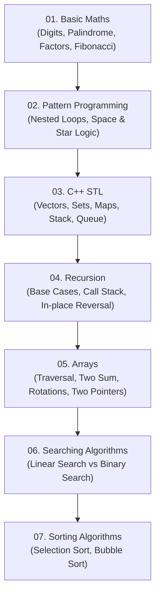

# Data Structures & Algorithms in C++ (DSA Roadmap)

Welcome to your structured DSA repository! This repository organizes your personal journey through fundamental Data Structures and Algorithms in C++, starting from the absolute basics (Math and Patterns) up through Standard Template Library (STL), Recursion, Arrays, Searching, and Sorting.

---

## 🗺️ Recommended Learning Roadmap

Study and revise the topics in this sequential order:



---

## 📂 Repository File Structure

```text
dsa_cpp/
├── 01_maths/
│   ├── basic_maths_part1.cpp          # Digit extraction, count, reverse, palindrome, min/max digit
│   └── basic_maths_part2.cpp          # Loops 1-to-N, tables, factorial, Fibonacci, divisors/factors
│
├── 02_patterns/
│   ├── 01_basic_patterns.cpp          # Squares, right triangles, inverted triangles, Floyd's, 0-1
│   ├── 02_medium_patterns.cpp         # Half pyramids, number and character pyramids
│   ├── 03_advance_patterns.cpp        # Full pyramids, inverted pyramids, diamond patterns
│   └── 04_hard_patterns.cpp           # Mirrored pyramids, hollow diamonds, concentric number spiral
│
├── 03_stl/
│   ├── stl_containers_overview.cpp    # Vector, Deque, List, Set, Map, Stack, Queue, Priority Queue
│   └── vector_operations.cpp          # Vector iterations, push_back, pop_back demos
│
├── 04_recursion/
│   ├── 01_recursion_basics.cpp        # Factorial, 1-to-N, N-to-1, recursive vector printing
│   ├── diagrams/
│   │   ├── recursion_call_stack.png       # Call stack memory diagram
│   │   ├── reverse_array_extra_vector.png # Auxiliary array recursion trace
│   │   └── reverse_array_two_pointer.png  # Two-pointer swap recursion trace
│   └── practice/
│       ├── recursive_linear_search.cpp    # Linear search implemented via recursion
│       ├── reverse_array_extra_vector.cpp # Array reversal with extra vector (O(N) space)
│       └── reverse_array_two_pointer.cpp  # Array reversal in-place with two pointers (O(1) aux space)
│
├── 05_arrays/
│   ├── 01_array_basics.cpp            # Static array declarations, garbage values, char arrays
│   ├── 02_array_operations.cpp        # Array traversal, doubling, even/odd, count 0/1, min/max
│   └── 03_array_problems.cpp          # Check sorted, Two Sum, Max Consecutive Ones, Left/Right Rotate
│
├── 06_searching/
│   ├── linear_search.cpp              # Linear search algorithm (O(N))
│   └── binary_search.cpp              # Binary search on sorted array (O(log N))
│
├── 07_sorting/
│   └── sorting_algorithms.cpp         # Selection Sort and Bubble Sort implementations
│
├── .gitignore                         # Ignores executables (*.exe, *.out, build/)
└── README.md                          # Repository documentation & guide
```

---

## 🔄 File Migration Map ("Where did my old files go?")

Use this lookup table to find any of your original files:

| Original Path | New Clean Path | What it Covers |
| :--- | :--- | :--- |
| `maths/basic_maths.cpp` | `01_maths/basic_maths_part1.cpp` | Digit operations, palindrome, min/max digits |
| `maths/basic_maths_part2.cpp` | `01_maths/basic_maths_part2.cpp` | Loops, Fibonacci, Factorial, Factors |
| `PATTERN_PROGRAMMING/normal_dsabasic_pattern+problrm.cpp` | `02_patterns/01_basic_patterns.cpp` | 12 starter pattern problems |
| `PATTERN_PROGRAMMING/normal_dsamidum_patter_progrm.cpp` | `02_patterns/02_medium_patterns.cpp` | Intermediate pyramid & triangle patterns |
| `PATTERN_PROGRAMMING/dsa_advance_pattern_programming.cpp` | `02_patterns/03_advance_patterns.cpp` | Full pyramids & diamond patterns |
| `PATTERN_PROGRAMMING/dsa_hard_pattern_programmiing.cpp` | `02_patterns/04_hard_patterns.cpp` | Hollow diamonds & concentric number spiral |
| `STL_CPP/STL_CONTAINERS.CPP` | `03_stl/stl_containers_overview.cpp` | Complete STL container guide with print templates |
| `STL_CPP/CONTAINERS /VECTORS_STL.CPP` | `03_stl/vector_operations.cpp` | Vector traversal and `.pop_back()` behavior |
| `RECRUSION_DSA/1st_file.cpp` | `04_recursion/01_recursion_basics.cpp` | Core recursion (factorial, 1 to N, vector traversal) |
| `RECRUSION_DSA/digrams /image.png` | `04_recursion/diagrams/recursion_call_stack.png` | Recursion call stack diagram |
| `RECRUSION_DSA/.../revrse_array_... .png` | `04_recursion/diagrams/reverse_array_extra_vector.png` | Diagram of extra-vector recursive reversal |
| `RECRUSION_DSA/.../rev_array_twopointer.png` | `04_recursion/diagrams/reverse_array_two_pointer.png` | Diagram of two-pointer recursive reversal |
| `RECRUSION_DSA/.../Linearsearch.cpp` | `04_recursion/practice/recursive_linear_search.cpp` | Linear search using recursion |
| `RECRUSION_DSA/.../revrseArrayusing_recrssion.cpp` | `04_recursion/practice/reverse_array_extra_vector.cpp` | Reverse array via recursion with new vector |
| `RECRUSION_DSA/.../revrse_array_..._recrsuuing.cpp` | `04_recursion/practice/reverse_array_two_pointer.cpp` | Reverse array via recursion using two pointers |
| `ARRAY/LECTURE_1.CPP` | `05_arrays/01_array_basics.cpp` | Static arrays, memory garbage, char arrays |
| `ARRAY/lecture_1_Part2.cpp` | `05_arrays/02_array_operations.cpp` | Min/max, counting 0s/1s, even/odd, basic search |
| `ARRAY/lecture_2_part1.cpp` | `05_arrays/03_array_problems.cpp` | Check sorted, Two Sum, Consecutive Ones, Rotate by 1 |
| `ARRAY_SEARCHING/Linear_Search_Algorithm.cpp` | `06_searching/linear_search.cpp` | Iterative linear search with detailed notes |
| `ARRAY_SEARCHING/BINARY_SEARCH_ALGO.CPP` | `06_searching/binary_search.cpp` | Binary search with overflow-safe mid calculation |
| `ARRAY/sorting.cpp` | `07_sorting/sorting_algorithms.cpp` | Selection Sort & optimized Bubble Sort |
| `ARRAY_SEARCHING/Linear_Search_Algorithm` | *(Removed)* | Compiled binary executable removed from git |

---

## 📚 Module-by-Module Guide & Key Concepts

### 1. Basic Maths (`01_maths/`)
Fundamental mathematical techniques required for DSA problem solving.
- **Digit Extraction**: Extract digits right-to-left using `n % 10`, remove the last digit using `n / 10`.
  - Time Complexity: \(O(\log_{10} N)\) because dividing by 10 reduces the number of digits by 1 in each step.
- **Palindrome Check**: Rebuild the reversed number (`rev = rev * 10 + digit`) and compare with the original value.
- **Fibonacci Sequence**: Iterative calculation using two rolling variables `t1` and `t2` (\(O(N)\) time, \(O(1)\) space).
- **Factors / Divisors**: Scanning divisors up to `N` (optimization tip: check up to \(\sqrt{N}\) for \(O(\sqrt{N})\) complexity).

### 2. Pattern Programming (`02_patterns/`)
Building nested loop intuition and mental models for matrix coordinates `(i, j)`.
- **The 3 Golden Rules of Pattern Printing**:
  1. **Outer loop (`i`)**: Controls rows (`0` to `n - 1` or `1` to `n`).
  2. **Inner loop 1**: Prints leading spaces if the pattern is right-aligned or centered.
  3. **Inner loop 2**: Prints stars, numbers, or characters based on a formula relating to row `i`.
- **Patterns covered**:
  - Right-angled triangles, inverted triangles, symmetric pyramids.
  - Number pyramids, alternating binary triangles (`0-1` pattern).
  - Floyd's triangle (continuous sequence of incrementing integers).
  - Number Crown (symmetric numbers with decreasing spaces in the middle).
  - Concentric square numbers (boundary-based minimum distance formula `min(min(i, j), min(2*n-2-i, 2*n-2-j))`).

### 3. C++ Standard Template Library (`03_stl/`)
Mastery over C++ STL containers and algorithms:
- **Sequence Containers**:
  - `std::vector`: Dynamic continuous array, \(O(1)\) amortized push_back, random access \(O(1)\).
  - `std::deque`: Double-ended queue, \(O(1)\) push/pop at both front and back.
  - `std::list`: Doubly-linked list, \(O(1)\) insertions/deletions anywhere given an iterator.
  - `std::array`: Fixed-size wrapper over C-style array with STL interface.
- **Associative Containers**:
  - `std::set` / `std::map`: Self-balancing Red-Black trees, elements sorted, \(O(\log N)\) insert/find/erase.
- **Unordered Associative Containers**:
  - `std::unordered_set` / `std::unordered_map`: Hash tables, \(O(1)\) average insert/find/erase, \(O(N)\) worst case on hash collisions.
- **Container Adaptors**:
  - `std::stack`: LIFO (Last-In-First-Out) adaptor (`push`, `pop`, `top`).
  - `std::queue`: FIFO (First-In-First-Out) adaptor (`push`, `pop`, `front`).
  - `std::priority_queue`: Heap-based (Max-Heap by default), \(O(\log N)\) push/pop, \(O(1)\) top.

### 4. Recursion (`04_recursion/`)
Thinking recursively: breaking large problems into smaller identical sub-problems.
- **Anatomy of Recursion**:
  1. **Base Case**: The stopping condition that prevents infinite calls and stack overflow.
  2. **Self Work / Small Computation**: What this specific frame computes.
  3. **Recursive Call**: Calling the function with modified arguments moving towards the base case.
- **Practiced Problems**:
  - `01_recursion_basics.cpp`: Factorial (\(O(N)\) time, \(O(N)\) call stack memory), printing sequences, recursive array traversal.
  - `recursive_linear_search.cpp`: Finding target recursively by scanning index `idx -> idx + 1`.
  - `reverse_array_extra_vector.cpp`: Recursively pushing from end into a new vector (\(O(N)\) extra space).
  - `reverse_array_two_pointer.cpp`: Recursively swapping `arr[left]` and `arr[right]` in-place (\(O(1)\) auxiliary memory, \(O(N)\) call stack).
- **Diagrams**: Visual handwritten diagrams in `04_recursion/diagrams/` illustrate the activation records and pointer shifts.

### 5. Arrays (`05_arrays/`)
Contiguous memory data structure and fundamental algorithmic patterns.
- `01_array_basics.cpp`:
  - Static vs dynamic arrays.
  - Understanding uninitialized stack memory (garbage values).
  - Character arrays and null termination.
- `02_array_operations.cpp`:
  - Linear scan for finding minimum and maximum elements in \(O(N)\).
  - Counting occurrences of specific values (e.g. 0s and 1s).
  - Filtering even and odd numbers.
- `03_array_problems.cpp`:
  - **Check if Array is Sorted**: Single-pass adjacent comparison \(O(N)\).
  - **Two Sum (Brute Force)**: Nested loops checking all pairs \((i, j)\) summing to target (\(O(N^2)\) time, \(O(1)\) space).
  - **Max Consecutive Ones**: Tracking current streak `cs` and best streak `ans` (\(O(N)\) time).
  - **Left Rotate by 1**: Storing `arr[0]`, shifting all elements left, placing `arr[0]` at the end.
  - **Right Rotate by 1**: Storing `arr[n-1]`, shifting elements right, placing `arr[n-1]` at index 0.
  - **Two-Pointer Vector Reverse**: Swapping `arr[left]` and `arr[right]` while `left < right` in \(O(N)\) time and \(O(1)\) space.

### 6. Searching Algorithms (`06_searching/`)
Comparing sequential search with logarithmic divide-and-conquer search.

| Algorithm | Precondition | Best Time | Worst Time | Space | Notes |
| :--- | :--- | :--- | :--- | :--- | :--- |
| **Linear Search** | None (works on unsorted arrays) | \(O(1)\) | \(O(N)\) | \(O(1)\) | Simple, best for small or unsorted datasets |
| **Binary Search** | **Array must be sorted** | \(O(1)\) | \(O(\log N)\) | \(O(1)\) | Halves search space each step |

> [!TIP]
> **Preventing Integer Overflow in Binary Search**:
> Instead of calculating `mid = (left + right) / 2` (which can overflow `int` if `left + right > INT_MAX`), always use:
> ```cpp
> int mid = left + (right - left) / 2;
> ```

### 7. Sorting Algorithms (`07_sorting/`)
Elementary comparison-based sorting algorithms:

- **Selection Sort**:
  - Concept: Divides array into sorted and unsorted parts. Repeatedly finds the minimum element in the unsorted portion and swaps it with the first unsorted element.
  - Time Complexity: \(O(N^2)\) in all cases (best, average, worst).
  - Space Complexity: \(O(1)\) in-place.
- **Bubble Sort**:
  - Concept: Repeatedly steps through the array, compares adjacent elements, and swaps them if they are in the wrong order. Large elements "bubble up" to the end.
  - Optimization: Uses an `isSwapped` flag. If no swaps occur in an entire pass, the array is already sorted and the algorithm terminates immediately.
  - Time Complexity: \(O(N^2)\) worst/average, \(O(N)\) best case (when already sorted).
  - Space Complexity: \(O(1)\) in-place.

---

## 🛠️ How to Compile & Run

### Method 1: Using the Terminal (g++)

You can compile and run any C++ file using GCC (`g++`):

```bash
# Compile
g++ -std=c++17 -Wall 05_arrays/03_array_problems.cpp -o run_problem

# Execute
./run_problem
```

### Method 2: In VS Code

1. Open any `.cpp` file in VS Code.
2. Use the **C/C++ Runner** extension button in the status bar or top right.
3. Or press `Ctrl + Shift + B` (or run your configured build task) to build and run.

---

## 🎯 Next Topics to Practice
Once you are confident with these fundamentals:
1. **Recursion Part 2**: Subsequences, Subsets, Permutations, Combination Sum.
2. **Intermediate Sorting**: Merge Sort (\(O(N \log N)\), divide and conquer), Quick Sort (\(O(N \log N)\) avg, in-place partition).
3. **Binary Search Advanced**: Lower Bound, Upper Bound, Search in Rotated Sorted Array, Binary Search on Answers (Book Allocation, Aggressive Cows).
4. **Hashing & Frequency Arrays**: Using `std::unordered_map` to solve Two Sum in \(O(N)\) time instead of \(O(N^2)\).
