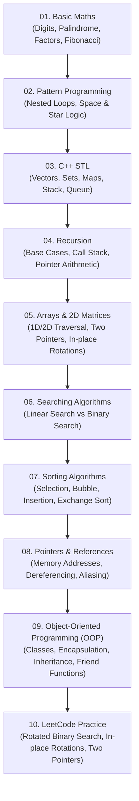

# Data Structures & Algorithms in C++ (DSA Roadmap)

Welcome to your structured DSA repository! This repository organizes your personal journey through fundamental Data Structures and Algorithms in C++, starting from the absolute basics (Math and Patterns) up through Standard Template Library (STL), Recursion, Arrays, 2D Matrices, Searching, Sorting, and LeetCode problem solutions.

---

## 🗺️ Recommended Learning Roadmap

Study and revise the topics in this sequential order:



---

## 📂 Repository File Structure

```text
dsa_cpp/
├── 01_maths/
│   ├── check_palindrome_number.cpp    # Check if an integer is a palindrome
│   ├── count_digits.cpp               # Count total digits in O(log10 N)
│   ├── count_even_and_odd_digits.cpp  # Separate counts of even and odd digits
│   ├── factorial_iterative.cpp        # Compute N! iteratively
│   ├── fibonacci_series.cpp           # Generate first N Fibonacci numbers
│   ├── min_and_max_digit.cpp          # Find smallest and largest digit in an integer
│   ├── multiplication_table.cpp       # Print N x 1 through N x 10 table
│   ├── print_1_to_n.cpp               # Print 1 to N sequentially
│   ├── print_all_digits.cpp           # Extract and print digits right-to-left
│   ├── print_all_factors.cpp          # Print all proper divisors of N
│   ├── print_even_and_odd_1_to_n.cpp  # Print even and odd numbers up to N
│   ├── reverse_number.cpp             # Reverse digits of an integer
│   ├── sum_1_to_n.cpp                 # Sum integers from 1 to N
│   └── sum_of_digits.cpp              # Sum all digits of an integer
│
├── 02_patterns/
│   ├── butterfly_star_pattern.cpp     # Symmetric butterfly star pattern
│   ├── diamond_star_pattern.cpp       # Centered full diamond star pattern
│   ├── full_star_pyramid.cpp          # Centered full & inverted star pyramids
│   ├── hollow_diamond_frame_pattern.cpp # Hollow diamond cutout star frame
│   ├── palindrome_number_pyramid.cpp  # Centered 1 / 1 2 1 / 1 2 3 2 1 pyramid
│   ├── right_aligned_alphabet_triangles.cpp # Mirrored alphabet triangles
│   ├── right_aligned_number_triangles.cpp   # Mirrored number triangles
│   ├── right_aligned_star_triangle.cpp      # Mirrored star triangle
│   ├── square_alphabet_patterns.cpp         # N x N alphabet & offset grids
│   ├── square_row_col_number_patterns.cpp   # N x N row/col/counting grids
│   ├── square_squares_and_cubes_patterns.cpp # N x N j^2 and j^3 grids
│   ├── square_star_and_constant_patterns.cpp # N x N star & constant number grids
│   ├── triangle_alphabet_patterns.cpp       # Half-pyramid alphabet triangles
│   ├── triangle_number_patterns.cpp         # Half-pyramid number triangles
│   └── triangle_star_and_inverted.cpp       # Right-angled & inverted star triangles
│
├── 03_stl/
│   ├── stl_containers_overview.cpp    # Vector, Deque, List, Set, Map, Stack, Queue, Priority Queue
│   └── vector_operations.cpp          # Vector iterations, push_back, pop_back demos
│
├── 04_recursion/
│   ├── binary_search_recursion.cpp         # Divide-and-conquer binary search via recursion (O(log N))
│   ├── check_if_array_is_sorted.cpp        # Pointer-arithmetic recursion to verify sorted order
│   ├── factorial_using_recursion.cpp       # Recursive factorial calculation (O(N))
│   ├── linear_search_recursion.cpp         # Linear search implemented via recursion
│   ├── print_array_elements_recursively.cpp # Print vector/array elements recursively
│   ├── print_counting_forward.cpp          # Print 1-to-N and range counting recursively
│   ├── print_counting_reverse.cpp          # Print N-to-1 counting recursively
│   ├── reverse_array_extra_vector.cpp      # Array reversal with extra vector (O(N) space)
│   ├── reverse_array_two_pointer.cpp       # Array reversal in-place with two pointers (O(1) space)
│   ├── sum_and_average_of_array.cpp        # Recursive sum and average calculation
│   └── diagrams/
│       ├── recursion_call_stack.png        # Call stack memory diagram
│       ├── reverse_array_extra_vector.png  # Auxiliary array recursion trace
│       └── reverse_array_two_pointer.png   # Two-pointer swap recursion trace
│
├── 05_arrays/
│   ├── array_basics_and_char_arrays.cpp    # Static int arrays, uninitialized garbage values, char arrays
│   ├── check_if_array_is_sorted.cpp        # Single-pass check for non-decreasing order
│   ├── check_palindrome_array.cpp          # Two-pointer palindrome check
│   ├── count_zeros_and_ones.cpp            # Count 0s and 1s in a binary array
│   ├── find_even_and_odd_numbers.cpp       # Filter and print even and odd elements
│   ├── find_min_and_max_in_array.cpp       # Find minimum and maximum elements in O(N)
│   ├── find_second_largest_and_smallest.cpp # Find 2nd largest & 2nd smallest in single pass
│   ├── left_rotate_array_by_one.cpp        # Left rotate array elements by 1 position
│   ├── linear_search_in_array.cpp          # Linear search returning target index or -1
│   ├── matrix_linear_search.cpp            # Search target coordinates (row, col) in 2D matrix
│   ├── matrix_min_and_max.cpp              # Find min and max values in a 2D matrix
│   ├── matrix_row_and_column_sum.cpp       # Compute row-wise and column-wise sums
│   ├── matrix_row_and_column_traversal.cpp # Row-major and column-major 2D array traversal
│   ├── max_consecutive_ones.cpp            # Longest streak of consecutive 1s in binary array
│   ├── merge_two_sorted_subarrays.cpp      # Merge two sorted subarrays arr[low..mid] & arr[mid+1..high]
│   ├── multiply_array_elements.cpp         # Double values / multiply vector elements by 10
│   ├── remove_duplicates_from_sorted_array.cpp # Remove duplicates in-place (Two Pointers)
│   ├── reverse_array_two_pointer.cpp       # Reverse array via extra vector & two-pointer swap
│   ├── right_rotate_array_by_one.cpp       # Right rotate array elements by 1 position
│   ├── shuffle_array_fisher_yates.cpp      # Fisher-Yates random shuffle in O(N)
│   ├── sum_and_average_of_array.cpp        # Sum and average of vector elements
│   └── two_sum_brute_force.cpp             # Brute force O(N^2) pair-sum search
│
├── 06_searching/
│   ├── linear_search.cpp              # Linear search algorithm (O(N))
│   └── binary_search.cpp              # Binary search on sorted array (O(log N))
│
├── 07_sorting/
│   ├── bubble_sort.cpp                # Bubble Sort with early-exit flag (O(N) best, O(N^2) worst)
│   ├── exchange_sort.cpp              # Exchange Sort comparing i vs j > i (O(N^2))
│   ├── insertion_sort.cpp             # Insertion Sort (O(N) best, O(N^2) worst)
│   ├── merge_sort.cpp                 # Merge Sort divide-and-conquer (O(N log N))
│   ├── quick_sort.cpp                 # Quick Sort using Lomuto partition (O(N log N) avg)
│   └── selection_sort.cpp             # Selection Sort selecting minimum element (O(N^2))
│
├── 08_pointers/
│   └── 01_pointer_basics.cpp          # Pointers, dereferencing (*), address-of (&), reference aliases
│
├── 09_oops/
│   ├── 01_classes_and_objects.cpp     # Class definition, public data members, instantiation, arrow/dot operator
│   ├── 02_class_methods.cpp           # Inside & outside class member functions using scope resolution (::)
│   ├── 03_constructors_and_destructors.cpp # Default & parameterized constructors, this pointer, destructor
│   ├── 04_access_specifiers.cpp       # Private vs Public, state variables, CarAgency & Buyer model
│   ├── 05_modular_class_design.cpp    # Modular 3-class design (CarAgency, Car, Buyer)
│   ├── 06_encapsulation_and_friend.cpp # Encapsulation, getter/setter validation, friend functions
│   ├── 07_inheritance_basics.cpp      # Single & hierarchical inheritance, constructor chaining, override
│   ├── 08_multilevel_inheritance.cpp  # Multilevel inheritance (Vechical -> Car -> SportsCar), protected access
│   └── comments_guide.txt             # Visual comments guide (// !, // ?, // *, // TODO, // NOTE)
│
├── leetcode/
│   └── arrays/
│       ├── lc_0033_search_in_rotated_sorted_array.cpp
│       ├── lc_0034_find_first_and_last_position_of_element_in_sorted_array.cpp
│       ├── lc_0048_rotate_image.cpp
│       ├── lc_0069_sqrtx.cpp
│       ├── lc_0074_search_a_2d_matrix.cpp
│       ├── lc_0088_merge_sorted_array.cpp
│       ├── lc_0167_two_sum_ii_input_array_is_sorted.cpp
│       ├── lc_0485_max_consecutive_ones.cpp
│       ├── lc_0724_find_pivot_index.cpp
│       ├── lc_0867_transpose_matrix.cpp
│       ├── lc_1470_shuffle_the_array.cpp
│       ├── lc_1572_matrix_diagonal_sum.cpp
│       └── lc_1991_find_the_middle_index_in_array.cpp
│
├── .gitignore                         # Ignores executables (*.exe, *.out, build/)
├── index.html                         # Interactive question checklist with tick marks & search
└── README.md                          # Repository documentation & guide
```

---

## 🔄 File Contents & Quick Reference

Use this lookup table to quickly locate any file and understand what it covers:

| Category | File Path | What it Covers |
| :--- | :--- | :--- |
| **01 Maths** | `01_maths/check_palindrome_number.cpp` | Check whether an integer is a palindrome |
| **01 Maths** | `01_maths/count_digits.cpp` | Count digits in $O(\log_{10} N)$ time |
| **01 Maths** | `01_maths/count_even_and_odd_digits.cpp` | Count even and odd digits in a number |
| **01 Maths** | `01_maths/factorial_iterative.cpp` | Iterative $N!$ computation |
| **01 Maths** | `01_maths/fibonacci_series.cpp` | Print first $N$ Fibonacci terms |
| **01 Maths** | `01_maths/min_and_max_digit.cpp` | Minimum and maximum digit in an integer |
| **01 Maths** | `01_maths/multiplication_table.cpp` | Multiplication table from 1 to 10 |
| **01 Maths** | `01_maths/print_1_to_n.cpp` | Loop printing 1 to $N$ |
| **01 Maths** | `01_maths/print_all_digits.cpp` | Extract and print all digits |
| **01 Maths** | `01_maths/print_all_factors.cpp` | List proper factors of $N$ |
| **01 Maths** | `01_maths/print_even_and_odd_1_to_n.cpp` | Print even and odd integers up to $N$ |
| **01 Maths** | `01_maths/reverse_number.cpp` | Reverse digits of an integer |
| **01 Maths** | `01_maths/sum_1_to_n.cpp` | Sum integers from 1 to $N$ |
| **01 Maths** | `01_maths/sum_of_digits.cpp` | Sum all digits of an integer |
| **02 Patterns** | `02_patterns/butterfly_star_pattern.cpp` | Symmetric butterfly star pattern |
| **02 Patterns** | `02_patterns/diamond_star_pattern.cpp` | Centered full diamond star pattern |
| **02 Patterns** | `02_patterns/full_star_pyramid.cpp` | Centered full and inverted star pyramids |
| **02 Patterns** | `02_patterns/hollow_diamond_frame_pattern.cpp` | Hollow diamond cutout star frame |
| **02 Patterns** | `02_patterns/palindrome_number_pyramid.cpp` | Centered palindrome number pyramid |
| **02 Patterns** | `02_patterns/right_aligned_alphabet_triangles.cpp` | Mirrored alphabet triangles |
| **02 Patterns** | `02_patterns/right_aligned_number_triangles.cpp` | Mirrored number triangles |
| **02 Patterns** | `02_patterns/right_aligned_star_triangle.cpp` | Mirrored star triangle |
| **02 Patterns** | `02_patterns/square_alphabet_patterns.cpp` | $N \times N$ alphabet and offset grids |
| **02 Patterns** | `02_patterns/square_row_col_number_patterns.cpp` | $N \times N$ row, column, and counting grids |
| **02 Patterns** | `02_patterns/square_squares_and_cubes_patterns.cpp` | $N \times N$ $j^2$ and $j^3$ grids |
| **02 Patterns** | `02_patterns/square_star_and_constant_patterns.cpp` | $N \times N$ star and constant number squares |
| **02 Patterns** | `02_patterns/triangle_alphabet_patterns.cpp` | Half-pyramid alphabet triangles |
| **02 Patterns** | `02_patterns/triangle_number_patterns.cpp` | Half-pyramid number triangles |
| **02 Patterns** | `02_patterns/triangle_star_and_inverted.cpp` | Right-angled and inverted star triangles |
| **03 STL** | `03_stl/stl_containers_overview.cpp` | Complete STL container guide with generic print templates |
| **03 STL** | `03_stl/vector_operations.cpp` | Vector traversal methods and `.pop_back()` behavior |
| **04 Recursion** | `04_recursion/binary_search_recursion.cpp` | Recursive Binary Search on sorted vector ($O(\log N)$) |
| **04 Recursion** | `04_recursion/check_if_array_is_sorted.cpp` | Pointer-arithmetic recursion (`arr + 1`, `size - 1`) to check sorted order |
| **04 Recursion** | `04_recursion/factorial_using_recursion.cpp` | Recursive factorial calculation with $N \le 0$ base case |
| **04 Recursion** | `04_recursion/linear_search_recursion.cpp` | Linear search using recursion with safe boundary checks |
| **04 Recursion** | `04_recursion/print_array_elements_recursively.cpp` | Print vector and pointer-based array elements recursively |
| **04 Recursion** | `04_recursion/print_counting_forward.cpp` | Print 1-to-N and range counting recursively |
| **04 Recursion** | `04_recursion/print_counting_reverse.cpp` | Print N-to-1 counting recursively |
| **04 Recursion** | `04_recursion/reverse_array_extra_vector.cpp` | Reverse array via recursion with extra vector ($O(N)$ space) |
| **04 Recursion** | `04_recursion/reverse_array_two_pointer.cpp` | Reverse array in-place via recursion using two pointers ($O(1)$ space) |
| **04 Recursion** | `04_recursion/sum_and_average_of_array.cpp` | Recursive array/vector sum and average calculation |
| **04 Recursion** | `04_recursion/diagrams/` | Call stack memory & two-pointer swap hand traces |
| **05 Arrays** | `05_arrays/array_basics_and_char_arrays.cpp` | Static arrays, uninitialized garbage values, char arrays |
| **05 Arrays** | `05_arrays/check_if_array_is_sorted.cpp` | Single-pass sorted check ($O(N)$) |
| **05 Arrays** | `05_arrays/check_palindrome_array.cpp` | Two-pointer palindrome check ($O(N)$) |
| **05 Arrays** | `05_arrays/count_zeros_and_ones.cpp` | Count 0s and 1s in a binary array |
| **05 Arrays** | `05_arrays/find_even_and_odd_numbers.cpp` | Filter and print even and odd elements |
| **05 Arrays** | `05_arrays/find_min_and_max_in_array.cpp` | Single-pass minimum and maximum element search |
| **05 Arrays** | `05_arrays/find_second_largest_and_smallest.cpp` | Find 2nd largest & 2nd smallest elements in $O(N)$ |
| **05 Arrays** | `05_arrays/left_rotate_array_by_one.cpp` | Left rotate array by 1 position in-place |
| **05 Arrays** | `05_arrays/linear_search_in_array.cpp` | Linear search returning target index or -1 |
| **05 Arrays** | `05_arrays/matrix_linear_search.cpp` | Search target `(row, col)` coordinates in 2D matrix |
| **05 Arrays** | `05_arrays/matrix_min_and_max.cpp` | Find extreme values across a 2D matrix |
| **05 Arrays** | `05_arrays/matrix_row_and_column_sum.cpp` | Compute row-wise and column-wise sum vectors |
| **05 Arrays** | `05_arrays/matrix_row_and_column_traversal.cpp` | Row-major and column-major 2D traversal |
| **05 Arrays** | `05_arrays/max_consecutive_ones.cpp` | Find longest streak of consecutive 1s |
| **05 Arrays** | `05_arrays/merge_two_sorted_subarrays.cpp` | Merge `arr[low..mid]` and `arr[mid+1..high]` |
| **05 Arrays** | `05_arrays/multiply_array_elements.cpp` | Print doubled values & scale vector elements by 10 |
| **05 Arrays** | `05_arrays/remove_duplicates_from_sorted_array.cpp` | Remove duplicates in-place using two pointers |
| **05 Arrays** | `05_arrays/reverse_array_two_pointer.cpp` | Reverse array using extra vector & two pointers |
| **05 Arrays** | `05_arrays/right_rotate_array_by_one.cpp` | Right rotate array by 1 position in-place |
| **05 Arrays** | `05_arrays/shuffle_array_fisher_yates.cpp` | Fisher-Yates randomization in $O(N)$ |
| **05 Arrays** | `05_arrays/sum_and_average_of_array.cpp` | Sum and average of vector elements |
| **05 Arrays** | `05_arrays/two_sum_brute_force.cpp` | Brute force $O(N^2)$ pair-sum search |
| **06 Searching** | `06_searching/linear_search.cpp` | Iterative linear search with detailed notes |
| **06 Searching** | `06_searching/binary_search.cpp` | Binary search with overflow-safe mid calculation |
| **07 Sorting** | `07_sorting/bubble_sort.cpp` | Bubble Sort with early-exit optimization ($O(N)$ best, $O(N^2)$ worst) |
| **07 Sorting** | `07_sorting/exchange_sort.cpp` | Exchange Sort comparing `vec[i]` against subsequent elements ($O(N^2)$) |
| **07 Sorting** | `07_sorting/insertion_sort.cpp` | Insertion Sort ($O(N)$ best, $O(N^2)$ worst) |
| **07 Sorting** | `07_sorting/merge_sort.cpp` | Divide-and-conquer Merge Sort ($O(N \log N)$) |
| **07 Sorting** | `07_sorting/quick_sort.cpp` | Lomuto partition Quick Sort ($O(N \log N)$ avg) |
| **07 Sorting** | `07_sorting/selection_sort.cpp` | Selection Sort selecting minimum element ($O(N^2)$) |
| **08 Pointers** | `08_pointers/01_pointer_basics.cpp` | Pointers (`*ptr`), address-of (`&var`), and reference variables (`&ref`) |
| **09 OOP** | `09_oops/01_classes_and_objects.cpp` | Class definition, public data members, instantiation, arrow/dot operator |
| **09 OOP** | `09_oops/02_class_methods.cpp` | Inside & outside member functions with scope resolution (`::`) |
| **09 OOP** | `09_oops/03_constructors_and_destructors.cpp` | Default & parameterized constructors, `this` pointer, destructor execution |
| **09 OOP** | `09_oops/04_access_specifiers.cpp` | `private` vs `public` access control, state management, CarAgency & Buyer |
| **09 OOP** | `09_oops/05_modular_class_design.cpp` | Modular multi-class architecture: `CarAgency`, `Car`, `Buyer` |
| **09 OOP** | `09_oops/06_encapsulation_and_friend.cpp` | Encapsulation, data hiding, validation getters/setters, `friend` functions |
| **09 OOP** | `09_oops/07_inheritance_basics.cpp` | Single & hierarchical inheritance, constructor chaining `: Vehical(...)`, method override |
| **09 OOP** | `09_oops/08_multilevel_inheritance.cpp` | Multilevel inheritance (`Vechical` $\to$ `Car` $\to$ `SportsCar`), `protected` access, `friend` |
| **09 OOP** | `09_oops/comments_guide.txt` | Better Comments cheat sheet for standardized code documentation |
| **LeetCode** | `leetcode/arrays/lc_0033_search_in_rotated_sorted_array.cpp` | LC 33: Search in Rotated Sorted Array ($O(\log N)$) |
| **LeetCode** | `leetcode/arrays/lc_0034_find_first_and_last_position_of_element_in_sorted_array.cpp` | LC 34: Find First and Last Position in Sorted Array ($O(\log N)$) |
| **LeetCode** | `leetcode/arrays/lc_0048_rotate_image.cpp` | LC 48: Rotate Image 90° clockwise in-place ($O(N^2)$) |
| **LeetCode** | `leetcode/arrays/lc_0069_sqrtx.cpp` | LC 69: Sqrt(x) using Binary Search ($O(\log x)$) |
| **LeetCode** | `leetcode/arrays/lc_0074_search_a_2d_matrix.cpp` | LC 74: Search a 2D Matrix ($O(\log(m \cdot n))$) |
| **LeetCode** | `leetcode/arrays/lc_0088_merge_sorted_array.cpp` | LC 88: Merge Sorted Array ($O(m + n)$ optimal backwards) |
| **LeetCode** | `leetcode/arrays/lc_0167_two_sum_ii_input_array_is_sorted.cpp` | LC 167: Two Sum II - Input Array Is Sorted ($O(N)$ Two Pointers) |
| **LeetCode** | `leetcode/arrays/lc_0485_max_consecutive_ones.cpp` | LC 485: Max Consecutive Ones ($O(N)$) |
| **LeetCode** | `leetcode/arrays/lc_0724_find_pivot_index.cpp` | LC 724: Find Pivot Index ($O(N)$ prefix/total sum) |
| **LeetCode** | `leetcode/arrays/lc_0867_transpose_matrix.cpp` | LC 867: Transpose Matrix ($O(R \cdot C)$) |
| **LeetCode** | `leetcode/arrays/lc_1470_shuffle_the_array.cpp` | LC 1470: Shuffle the Array ($O(N)$) |
| **LeetCode** | `leetcode/arrays/lc_1572_matrix_diagonal_sum.cpp` | LC 1572: Matrix Diagonal Sum ($O(N)$) |
| **LeetCode** | `leetcode/arrays/lc_1991_find_the_middle_index_in_array.cpp` | LC 1991: Find the Middle Index in Array ($O(N)$) |

---

## 📚 Module-by-Module Guide & Key Concepts

### 1. Basic Maths (`01_maths/`)
Fundamental mathematical techniques required for DSA problem solving.
- **Digit Extraction**: Extract digits right-to-left using `n % 10`, remove the last digit using `n / 10`.
  - Time Complexity: \(O(\log_{10} N)\) because dividing by 10 reduces the number of digits by 1 in each step.
- **Palindrome Check**: Rebuild the reversed number (`rev = rev * 10 + digit`) and compare with the original value.
- **Fibonacci Sequence**: Iterative calculation using two rolling variables `t1` and `t2` (\(O(N)\) time, \(O(1)\) space).
- **Factors / Divisors**: Scanning divisors up to `N` (optimization tip: check up to \(\sqrt{N}\) for \(O(\sqrt{N})\) complexity).

### 2. Pattern Programming (`02_patterns/`)
Building nested loop intuition and mental models for matrix coordinates `(i, j)`.
- **The 3 Golden Rules of Pattern Printing**:
  1. **Outer loop (`i`)**: Controls rows (`0` to `n - 1` or `1` to `n`).
  2. **Inner loop 1**: Prints leading spaces if the pattern is right-aligned or centered.
  3. **Inner loop 2**: Prints stars, numbers, or characters based on a formula relating to row `i`.
- **Patterns covered**:
  - Right-angled triangles, inverted triangles, symmetric pyramids.
  - Number pyramids, alternating binary triangles (`0-1` pattern).
  - Floyd's triangle (continuous sequence of incrementing integers).
  - Number Crown (symmetric numbers with decreasing spaces in the middle).
  - Concentric square numbers (boundary-based minimum distance formula `min(min(i, j), min(2*n-2-i, 2*n-2-j))`).

### 3. C++ Standard Template Library (`03_stl/`)
Mastery over C++ STL containers and algorithms:
- **Sequence Containers**:
  - `std::vector`: Dynamic continuous array, \(O(1)\) amortized push_back, random access \(O(1)\).
  - `std::deque`: Double-ended queue, \(O(1)\) push/pop at both front and back.
  - `std::list`: Doubly-linked list, \(O(1)\) insertions/deletions anywhere given an iterator.
  - `std::array`: Fixed-size wrapper over C-style array with STL interface.
- **Associative Containers**:
  - `std::set` / `std::map`: Self-balancing Red-Black trees, elements sorted, \(O(\log N)\) insert/find/erase.
- **Unordered Associative Containers**:
  - `std::unordered_set` / `std::unordered_map`: Hash tables, \(O(1)\) average insert/find/erase, \(O(N)\) worst case on hash collisions.
- **Container Adaptors**:
  - `std::stack`: LIFO (Last-In-First-Out) adaptor (`push`, `pop`, `top`).
  - `std::queue`: FIFO (First-In-First-Out) adaptor (`push`, `pop`, `front`).
  - `std::priority_queue`: Heap-based (Max-Heap by default), \(O(\log N)\) push/pop, \(O(1)\) top.

### 4. Recursion (`04_recursion/`)
Thinking recursively: breaking large problems into smaller identical sub-problems, organized one question per file:
- **Anatomy of Recursion**:
  1. **Base Case**: The stopping condition that prevents infinite calls and stack overflow.
  2. **Self Work / Small Computation**: What this specific frame computes.
  3. **Recursive Call**: Calling the function with modified arguments moving towards the base case.

- **Files in this Module**:
  - **`factorial_using_recursion.cpp`**: Factorial calculation (\(O(N)\)) with $N \le 0$ base case.
  - **`print_counting_reverse.cpp`**: Prints $N$ down to 1 recursively.
  - **`print_counting_forward.cpp`**: Prints 1 up to $N$ and arbitrary ranges recursively.
  - **`print_array_elements_recursively.cpp`**: Traverses both `std::vector` (indexed) and raw arrays (`arr + 1`, `size - 1`).
  - **`sum_and_average_of_array.cpp`**: Recursive sum and average calculation using vector and pointer recursion.
  - **`check_if_array_is_sorted.cpp`**: Pointer-arithmetic recursion verifying sorted order (`arr[0] > arr[1]` $\to$ `false`).
  - **`linear_search_recursion.cpp`**: Finding target index recursively with safe boundary checks.
  - **`binary_search_recursion.cpp`**: Divide-and-conquer binary search on sorted array via recursion (\(O(\log N)\)).
  - **`reverse_array_extra_vector.cpp`**: Reverse array recursively by pushing into a new vector (\(O(N)\) space).
  - **`reverse_array_two_pointer.cpp`**: In-place two-pointer recursive swap (\(O(1)\) auxiliary memory).
  - **`diagrams/`**: Hand-drawn traces of call stacks and two-pointer swap mechanisms.

### 5. Arrays & 2D Matrices (`05_arrays/`)
Contiguous memory data structures, 1D/2D matrix operations, and fundamental algorithmic patterns, organized cleanly one question per file:
- **Fundamentals & Traversals**:
  - **`array_basics_and_char_arrays.cpp`**: Static arrays, uninitialized stack garbage values, and character arrays.
  - **`multiply_array_elements.cpp`**, **`sum_and_average_of_array.cpp`**, **`find_even_and_odd_numbers.cpp`**, **`count_zeros_and_ones.cpp`**: Element-wise scaling, aggregation, filtering, and counting.
- **Searching, Extremes & Order Checks**:
  - **`linear_search_in_array.cpp`**: Sequential target search returning index or `-1`.
  - **`find_min_and_max_in_array.cpp`**: Single-pass extreme element search in \(O(N)\).
  - **`find_second_largest_and_smallest.cpp`**: Single-pass second largest and second smallest distinct values in \(O(N)\).
  - **`check_if_array_is_sorted.cpp`**: Single-pass adjacent comparison \(O(N)\).
- **Two Pointers, Rotations & Transformations**:
  - **`reverse_array_two_pointer.cpp`**: Extra-vector reversal (\(O(N)\) space) and in-place two-pointer swap (\(O(1)\) space).
  - **`check_palindrome_array.cpp`**: Outer-to-inner symmetric equality checks.
  - **`left_rotate_array_by_one.cpp`** & **`right_rotate_array_by_one.cpp`**: Single-step cyclic shifts in \(O(N)\).
  - **`remove_duplicates_from_sorted_array.cpp`**: In-place deduplication returning unique length.
  - **`merge_two_sorted_subarrays.cpp`**: Merging `arr[low..mid]` and `arr[mid+1..high]`.
  - **`max_consecutive_ones.cpp`**, **`two_sum_brute_force.cpp`**, **`shuffle_array_fisher_yates.cpp`**: Streak tracking, \(O(N^2)\) pair search, and Fisher-Yates shuffle.
- **2D Arrays & Matrices**:
  - **`matrix_row_and_column_traversal.cpp`**: Row-major (`arr[i][j]`) and column-major (`arr[j][i]`) traversal.
  - **`matrix_row_and_column_sum.cpp`**: Accumulating row-wise and column-wise sums into 1D vectors.
  - **`matrix_linear_search.cpp`** & **`matrix_min_and_max.cpp`**: Finding `(row, col)` coordinates and extreme values across 2D matrices.

### 6. Searching Algorithms (`06_searching/`)
Comparing sequential search with logarithmic divide-and-conquer search.

| Algorithm | Precondition | Best Time | Worst Time | Space | Notes |
| :--- | :--- | :--- | :--- | :--- | :--- |
| **Linear Search** | None (works on unsorted arrays) | \(O(1)\) | \(O(N)\) | \(O(1)\) | Simple, best for small or unsorted datasets |
| **Binary Search** | **Array must be sorted** | \(O(1)\) | \(O(\log N)\) | \(O(1)\) | Halves search space each step |

> [!TIP]
> **Preventing Integer Overflow in Binary Search**:
> Instead of calculating `mid = (left + right) / 2` (which can overflow `int` if `left + right > INT_MAX`), always use:
> ```cpp
> int mid = left + (right - left) / 2;
> ```

### 7. Sorting Algorithms (`07_sorting/`)
Comparison-based and divide-and-conquer sorting algorithms, each in its own standalone file:

- **Selection Sort (`selection_sort.cpp`)**:
  - **Concept**: Divides the array into sorted and unsorted regions. In each pass, finds the minimum element in the unsorted portion and swaps it with the first unsorted element.
  - **Time Complexity**: \(O(N^2)\) in all cases (best, average, worst).
  - **Space Complexity**: \(O(1)\) in-place.
- **Bubble Sort (`bubble_sort.cpp`)**:
  - **Concept**: Repeatedly steps through the array, compares adjacent elements, and swaps them if they are in the wrong order. Uses a `swapped` flag to terminate early in \(O(N)\) if already sorted.
  - **Time Complexity**: \(O(N^2)\) worst/average, \(O(N)\) best case.
  - **Space Complexity**: \(O(1)\) in-place.
- **Insertion Sort (`insertion_sort.cpp`)**:
  - **Concept**: Builds the sorted array one element at a time by swapping backwards while smaller than the preceding element.
  - **Time Complexity**: \(O(N)\) best case (when already sorted), \(O(N^2)\) worst case.
  - **Space Complexity**: \(O(1)\) in-place.
- **Exchange Sort (`exchange_sort.cpp`)**:
  - **Concept**: Compares the current element `vec[i]` against all subsequent elements `vec[j]` ($j > i$) and swaps immediately whenever `vec[i] > vec[j]`.
  - **Time Complexity**: \(O(N^2)\) in all cases.
  - **Space Complexity**: \(O(1)\) in-place.
- **Merge Sort (`merge_sort.cpp`)**:
  - **Concept**: Divide-and-conquer sorting that splits the array into halves recursively and merges sorted halves back together.
  - **Time Complexity**: \(O(N \log N)\) in all cases.
  - **Space Complexity**: \(O(N)\) auxiliary space.
- **Quick Sort (`quick_sort.cpp`)**:
  - **Concept**: Divide-and-conquer using Lomuto partition around a pivot element so smaller elements sit left and larger sit right.
  - **Time Complexity**: \(O(N \log N)\) best/average, \(O(N^2)\) worst case.
  - **Space Complexity**: \(O(\log N)\) recursion stack average.

#### Sorting Comparison Matrix

| Algorithm | Best Time | Average Time | Worst Time | Space | Stable? | In-Place? | Key Mechanism |
| :--- | :---: | :---: | :---: | :---: | :---: | :---: | :--- |
| **Selection Sort** | \(O(N^2)\) | \(O(N^2)\) | \(O(N^2)\) | \(O(1)\) | No | Yes | Find minimum element, swap to current index |
| **Bubble Sort** | \(O(N)\)* | \(O(N^2)\) | \(O(N^2)\) | \(O(1)\) | Yes | Yes | Swap adjacent out-of-order elements (*with swap flag) |
| **Insertion Sort** | \(O(N)\) | \(O(N^2)\) | \(O(N^2)\) | \(O(1)\) | Yes | Yes | Repeatedly swap backwards into sorted partition |
| **Exchange Sort** | \(O(N^2)\) | \(O(N^2)\) | \(O(N^2)\) | \(O(1)\) | No | Yes | Swap whenever `vec[i] > vec[j]` across nested loops |
| **Merge Sort** | \(O(N \log N)\) | \(O(N \log N)\) | \(O(N \log N)\) | \(O(N)\) | Yes | No | Recursively split and merge sorted halves |
| **Quick Sort** | \(O(N \log N)\) | \(O(N \log N)\) | \(O(N^2)\) | \(O(\log N)\) | No | Yes | Partition around pivot and sort subarrays |

### 8. Pointers & References (`08_pointers/`)
Core C++ memory management, addressing, and referencing fundamentals:
- **Address-of Operator (`&`)**: Retrieves the hexadecimal memory address where a variable resides in RAM.
- **Pointers (`int *ptr = &var`)**: A variable holding the memory address of another variable.
- **Dereference Operator (`*ptr`)**: Accesses or modifies the value stored at the address pointed to by `ptr`.
- **Reference Variables (`int &ref = var`)**: An alias or alternative identifier sharing the exact same memory location as `var`, allowing direct in-place modifications without pointer syntax.

### 9. Object-Oriented Programming (OOP) (`09_oops/`)
Core Object-Oriented Programming pillars, design patterns, and C++ language mechanisms:
- **`01_classes_and_objects.cpp` (Classes & Objects)**:
  - User-defined blueprint `class` creating custom types.
  - Instantiating objects on stack memory.
  - Setting and accessing public data attributes with dot `.` and arrow `->` operators.
- **`02_class_methods.cpp` (Class Methods)**:
  - Defining member methods inside class declaration.
  - Defining methods outside the class using the scope resolution operator (`::`).
  - Accessing internal object attributes directly within class member scope.
- **`03_constructors_and_destructors.cpp` (Constructors & Destructors)**:
  - Default constructors, parameterized constructors, and initializer lists.
  - Disambiguating shadowed member variable names using the `this` self-pointer (`this->x = x`).
  - Automatic destructor execution (`~ClassName()`) cleaning up resources when objects leave scope.
- **`04_access_specifiers.cpp` (Access Specifiers & State Management)**:
  - Understanding `private` (accessible only within class) vs `public` (accessible anywhere).
  - Business logic modeling: `CarAgency` managing inventory and `Buyer` purchasing cars via methods rather than direct state variable mutation.
- **`05_modular_class_design.cpp` (Modular Architecture)**:
  - Clean separation of concerns between `CarAgency`, `Car`, and `Buyer` classes.
  - Object composition and method chaining.
- **`06_encapsulation_and_friend.cpp` (Encapsulation & Friend Functions)**:
  - **Encapsulation**: Bundling state and behaviors together while preventing unauthorized external modification via validated getters and setters.
  - **`friend` Functions**: Non-member functions granted special privileges to access `private` and `protected` class members without breaking class encapsulation.
- **`07_inheritance_basics.cpp` (Single & Hierarchical Inheritance)**:
  - Code reusability through inheritance (`class Car : public Vehical`).
  - Hierarchical inheritance sharing base class `Vehical` across multiple derived classes (`Car`, `Truck`).
  - Base class constructor chaining (`Car(...) : Vehical(...)`).
  - Method overriding where derived classes customize base class behaviors.
- **`08_multilevel_inheritance.cpp` (Multilevel Inheritance & Protected Specifier)**:
  - Multilevel inheritance chains (`Vechical` $\to$ `Car` $\to$ `SportsCar`).
  - `protected` access specifier: hidden from outside code, accessible to derived classes.
  - Accessing protected base members through friend functions.
- **`comments_guide.txt` (Code Commenting Standards)**:
  - Quick reference for VS Code Better Comments tags:
    - `// !` Critical alerts / warnings
    - `// ?` Questions / queries
    - `// *` Important highlights
    - `// TODO` Upcoming refactors / tasks
    - `// NOTE` Key architectural observations

### 10. LeetCode Practice (`leetcode/arrays/`)
Dedicated competitive programming problem solutions, organized cleanly and numbered by question:

1. **LeetCode 33: Search in Rotated Sorted Array (`lc_0033_search_in_rotated_sorted_array.cpp`)**:
   - Modified Binary Search determining which half is continuously sorted, then checking if the target falls within that sorted segment.
   - **Complexity**: \(O(\log N)\) time, \(O(1)\) space.

2. **LeetCode 34: Find First and Last Position of Element in Sorted Array (`lc_0034_find_first_and_last_position_of_element_in_sorted_array.cpp`)**:
   - Two Binary Searches (`startSearch` and `endSearch`) isolating the first and last target occurrences.
   - **Complexity**: \(O(\log N)\) time, \(O(1)\) auxiliary space.

3. **LeetCode 48: Rotate Image (`lc_0048_rotate_image.cpp`)**:
   - Rotates an \(N \times N\) matrix 90° clockwise in-place:
     1. Transpose the square matrix in-place (`swap(matrix[i][j], matrix[j][i])`).
     2. Reverse each row using `std::reverse`.
   - **Complexity**: \(O(N^2)\) time, \(O(1)\) auxiliary space.

4. **LeetCode 69: Sqrt(x) (`lc_0069_sqrtx.cpp`)**:
   - Binary Search over range $[1, x/2]$ to find $\lfloor \sqrt{x} \rfloor$ with `long long` overflow prevention.
   - **Complexity**: \(O(\log x)\) time, \(O(1)\) space.

5. **LeetCode 74: Search a 2D Matrix (`lc_0074_search_a_2d_matrix.cpp`)**:
   - 2-stage Binary Search: row binary search in \(O(\log m)\) followed by column binary search in \(O(\log n)\).
   - **Complexity**: \(O(\log(m \cdot n))\) time, \(O(1)\) space.

6. **LeetCode 88: Merge Sorted Array (`lc_0088_merge_sorted_array.cpp`)**:
   - Approach 1: Append `nums2` and `std::sort()` in \(O((m + n)\log(m + n))\).
   - Approach 2 (Optimal): 3-pointer backwards merge from index $m + n - 1$ down to 0 in \(O(m + n)\) time and \(O(1)\) space.

7. **LeetCode 167: Two Sum II - Input Array Is Sorted (`lc_0167_two_sum_ii_input_array_is_sorted.cpp`)**:
   - Two Pointers technique on non-decreasing sorted array:
     - Initialize `start = 0`, `end = n - 1`.
     - When `numbers[start] + numbers[end] == target`, returns 1-based indices `{start + 1, end + 1}`.
     - If the sum exceeds target, decrement `end--`; if below target, increment `start++`.
   - **Complexity**: \(O(N)\) time, \(O(1)\) auxiliary space.

8. **LeetCode 485: Max Consecutive Ones (`lc_0485_max_consecutive_ones.cpp`)**:
   - Single-pass counter tracking streak and max count, resetting on zeros.
   - **Complexity**: \(O(N)\) time, \(O(1)\) space.

9. **LeetCode 724: Find Pivot Index (`lc_0724_find_pivot_index.cpp`)**:
   - Computes total array sum, then scans while verifying `total - leftSum - vec[i] == leftSum`.
   - **Complexity**: \(O(N)\) time, \(O(1)\) space.

10. **LeetCode 867: Transpose Matrix (`lc_0867_transpose_matrix.cpp`)**:
    - Transposes rectangular $R \times C \to C \times R$ matrices.
    - **Complexity**: \(O(R \cdot C)\) time and space.

11. **LeetCode 1470: Shuffle the Array (`lc_1470_shuffle_the_array.cpp`)**:
    - Interleaves $[x_1 \dots x_n, y_1 \dots y_n]$ into $[x_1, y_1 \dots x_n, y_n]$.
    - **Complexity**: \(O(N)\) time, \(O(N)\) auxiliary space.

12. **LeetCode 1572: Matrix Diagonal Sum (`lc_1572_matrix_diagonal_sum.cpp`)**:
    - Sums primary and secondary diagonals in single pass, omitting center duplication when $N$ is odd.
    - **Complexity**: \(O(N)\) time, \(O(1)\) space.

13. **LeetCode 1991: Find the Middle Index in Array (`lc_1991_find_the_middle_index_in_array.cpp`)**:
    - Returns earliest index where left sum equals right sum.
    - **Complexity**: \(O(N)\) time, \(O(1)\) space.

---

## 🛠️ How to Compile & Run

### Method 1: Using the Terminal (g++)

You can compile and run any C++ file using GCC (`g++`):

```bash
# Example: Compile and run any LeetCode problem solution
g++ -std=c++17 -Wall leetcode/arrays/lc_0033_search_in_rotated_sorted_array.cpp -o run_lc && ./run_lc
g++ -std=c++17 -Wall leetcode/arrays/lc_0069_sqrtx.cpp -o run_sqrt && ./run_sqrt
g++ -std=c++17 -Wall leetcode/arrays/lc_0724_find_pivot_index.cpp -o run_pivot && ./run_pivot

# Example 2: Compile and run 2D matrix operations
g++ -std=c++17 -Wall 05_arrays/matrix_row_and_column_sum.cpp -o run_2d && ./run_2d

# Example 3: Compile and run array questions
g++ -std=c++17 -Wall 05_arrays/find_second_largest_and_smallest.cpp -o run_arr && ./run_arr

# Example 4: Compile and run sorting algorithms
g++ -std=c++17 -Wall 07_sorting/merge_sort.cpp -o run_sort && ./run_sort
g++ -std=c++17 -Wall 07_sorting/quick_sort.cpp -o run_qsort && ./run_qsort

# Example 5: Compile and run pointer & reference basics
g++ -std=c++17 -Wall 08_pointers/01_pointer_basics.cpp -o run_ptr && ./run_ptr

# Example 6: Compile and run OOP fundamentals
g++ -std=c++17 -Wall 09_oops/01_classes_and_objects.cpp -o run_oop && ./run_oop
g++ -std=c++17 -Wall 09_oops/08_multilevel_inheritance.cpp -o run_inherit && ./run_inherit
```

### Method 2: In VS Code

1. Open any `.cpp` file in VS Code.
2. Use the **C/C++ Runner** extension button in the status bar or top right.
3. Or press `Ctrl + Shift + B` (or run your configured build task) to build and run.

---

## 🎯 Next Topics to Practice
Once you are confident with these fundamentals:
1. **2D Matrix Advanced**: Spiral Matrix Traversal (LC 54), Search in 2D Matrix (LC 74), Set Matrix Zeroes (LC 73).
2. **Intermediate Sorting**: Merge Sort (\(O(N \log N)\), divide and conquer), Quick Sort (\(O(N \log N)\) avg, in-place partition).
3. **Binary Search Advanced**: Lower Bound, Upper Bound, Search in Rotated Sorted Array, Binary Search on Answers (Book Allocation, Aggressive Cows).
4. **Hashing & Frequency Arrays**: Using `std::unordered_map` to solve Two Sum in \(O(N)\) time instead of \(O(N^2)\).
